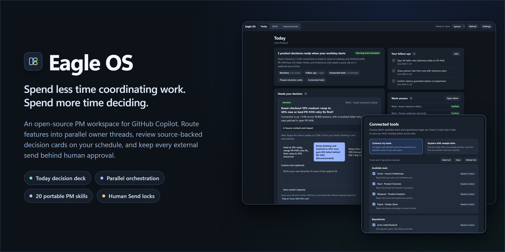
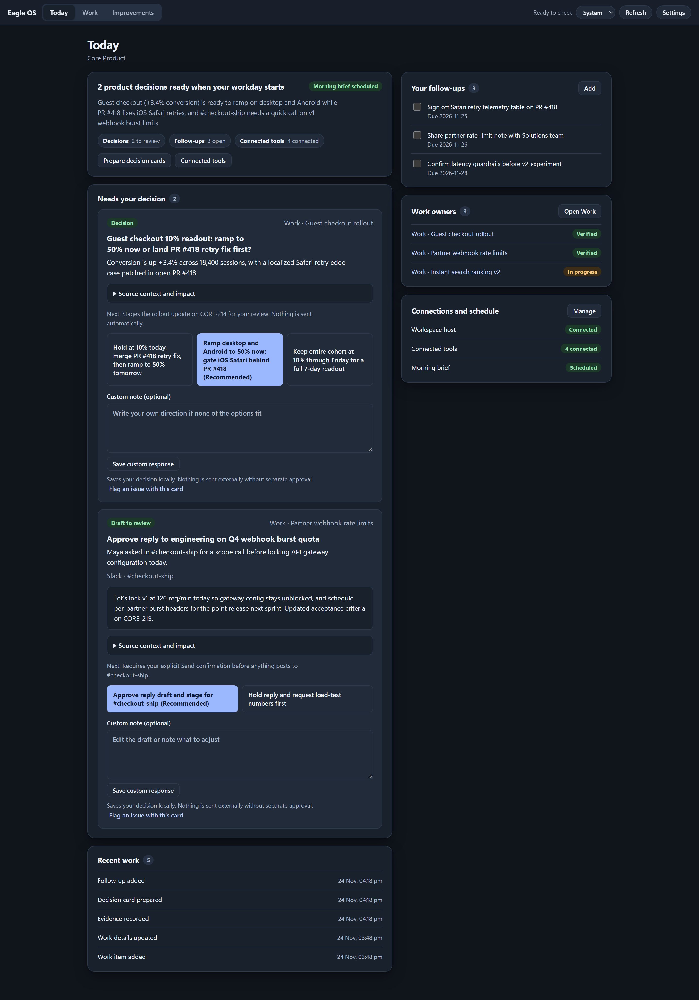
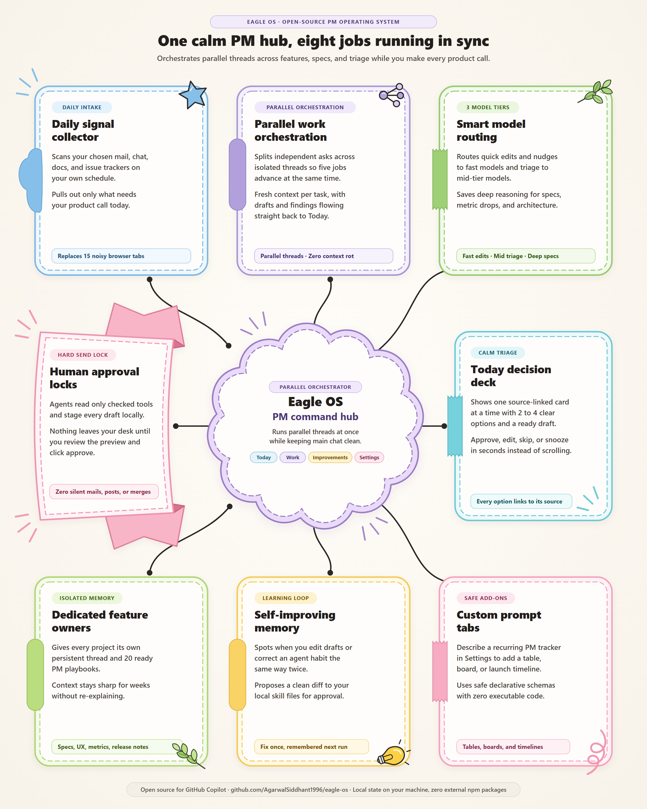
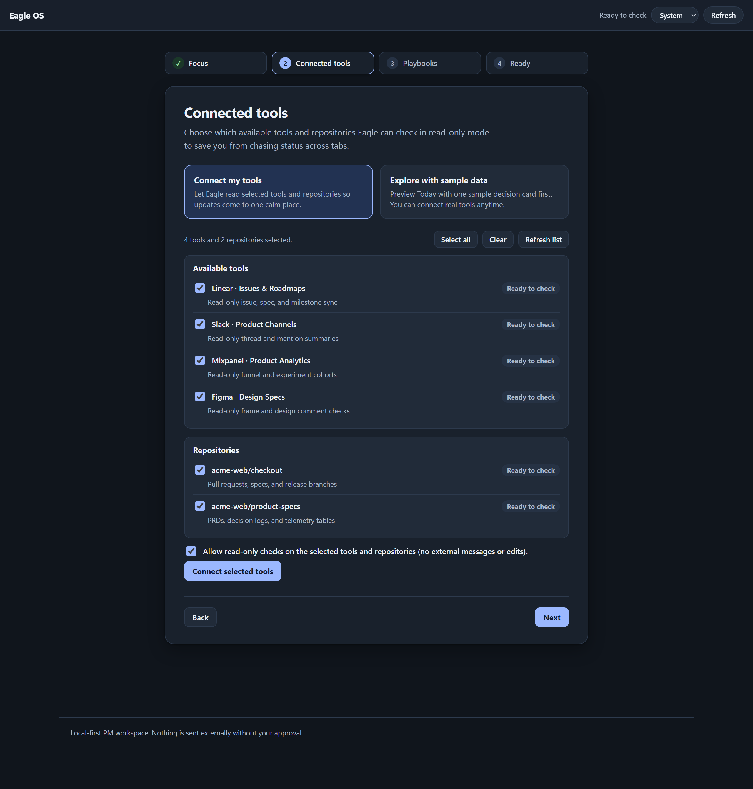

<p align="center">
  
</p>

<p align="center">
  <a href="LICENSE"></a>
  
  
  <a href="docs/skills.md"></a>
</p>

<h3 align="center">An AI-native product management workspace for GitHub Copilot.</h3>

<p align="center">
  Product managers lose hours piecing together issue trackers, chats, analytics, specs, and scattered AI threads.<br>
  Eagle OS gives you one calm <b>Today decision deck</b>, routes features into <b>parallel workstream threads</b>, ships <b>20 portable PM skills</b>, and keeps every external action behind <b>your approval</b>.
</p>

<p align="center">
  <a href="#quickstart">Quickstart</a> · <a href="#what-your-ai-does-vs-what-you-decide">Today deck</a> · <a href="#how-parallel-orchestration-works">Orchestration</a> · <a href="#whats-included">What's included</a> · <a href="docs/host-integration.md">Docs</a>
</p>

---

## What your AI does vs. what you decide

| Job | Eagle OS + your Copilot | You (the PM) |
| --- | --- | --- |
| **Daily triage** | Checks selected tools on your schedule and prepares source-backed decision cards | Open `Today` when your workday starts and pick an option |
| **Parallel work** | Routes each feature, spec, or review into its own thread on a Fast, Mid, or Complex model | Steer priorities from one control chat without context rot |
| **Specs & replies** | Drafts PRDs, telemetry tables, and stakeholder replies grounded in source evidence | Review the staged preview and adjust wording in your voice |
| **External actions** | Tracks `stored`, `accepted`, and `verified` states separately on your machine | Approve every send, ticket edit, or schedule change first |
| **Workflow memory** | Groups repeated card feedback into exact local skill diffs in `Improvements` | Approve only the rule changes you want to keep |

<p align="center">
  
</p>

---

## How parallel orchestration works

- **One calm control chat:** Give direction and review finished options in one place instead of digging through giant threads.
- **Isolated owner threads:** Each feature, experiment, or review runs in a fresh context window with a right-sized Fast, Mid, or Complex model.
- **Evidence-gated handoffs:** Queued messages record as `accepted` and only become `verified` when matching source evidence returns.
- **Optional remote checks:** Long checks can run on a configured secondary worker with explicit resource locks and typed status envelopes.

<p align="center">
  
</p>

---

## Quickstart

Requires **Node 22+** with zero external npm dependencies. Workspace data stays outside the repository in `~/.copilot/eagle-os-data/`.

**1. Browser mode (30 seconds)**

```sh
npm run check
npm start
```

Open the local URL printed in your terminal to explore with sample data or connect tools in read-only mode.

**2. GitHub Copilot Canvas**

Ask Copilot to install `extensions/eagle-os` via `install_extension` (`scope: "session"`), reload extensions, and open:

```json
{"canvasId":"eagle-os","instanceId":"eagle-review","input":{"workspace":"review"}}
```

New workspaces open a four-step PM setup (**Your focus -> Connected tools -> PM skills -> Morning brief**) on your chosen schedule, without connecting accounts or overwriting global skills automatically.

<p align="center">
  
</p>

---

## What's included

| Included | Summary | Reference |
| --- | --- | --- |
| **Today** | Morning brief, source-backed decision cards, staged reply previews, and follow-ups | [Onboarding](docs/onboarding.md) |
| **Work** | Parallel workstreams, real owner-thread bindings, evidence picker, and declarative add-on tabs | [Orchestration](docs/orchestration.md) |
| **20 PM skills** | Opt-in skill packs for specs, telemetry, research, experiments, updates, and routing | [Skills](docs/skills.md) |
| **Improvements** | Flag friction on any card, group repeated patterns, and approve exact local skill diffs | [Improvements](docs/improvements.md) |
| **Hard Send locks** | Read-only tool opt-in, session-scoped install, CLI revision checks, and release sanitizer | [Host & CLI](docs/host-integration.md) · [Privacy](docs/privacy.md) |

Further reference: [Install & updates](docs/install-update.md) · [Adapter contract](docs/adapters.md) · [MIT License](LICENSE)
