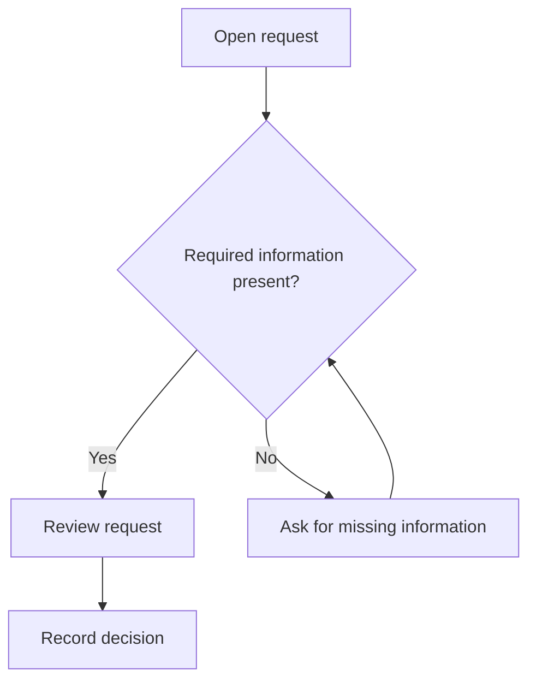

# Flowcharts

## Establish the story
Identify the audience, starting event, end state, actors, and the question the diagram should answer. Choose one level of detail. For a user journey, name user-visible actions; for an implementation flow, use confirmed system steps. Do not mix the two without explicit lanes or labels.

## Draw
1. List the supported steps before drawing. Associate non-obvious transitions with a supplied source or mark them as proposed.
2. Use short labels with everyday verbs. Put actions in rectangles and questions at decision points.
3. Give each decision outgoing conditions that are mutually understandable, such as "Allowed" and "Not allowed". Include the main failure and recovery route.
4. Show a clear start and terminal outcomes. Label loops with their exit condition. If the flow becomes crowded, split a subprocess rather than shrinking text.
5. Use plain text or a supported text-diagram format. Use a renderer only if one is actually available; do not claim a diagram was rendered or verified when only source text exists.
6. Trace one normal path and one failure path through the finished diagram. Check that no decision has an unlabeled exit and no required action is unreachable.

## Neutral example

## Boundaries and output
Keep private identifiers and real account details out of labels. Do not infer hidden processing or permissions from a screen alone. Mark proposed behavior, unknown paths, and evidence gaps visibly. Creating a diagram does not authorize changing the process or publishing it externally.

Return the diagram, a one-sentence explanation, and only the caveats needed to interpret it. Provide a text equivalent when the audience may not have diagram rendering.
